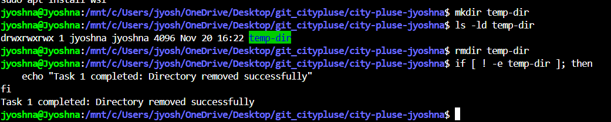
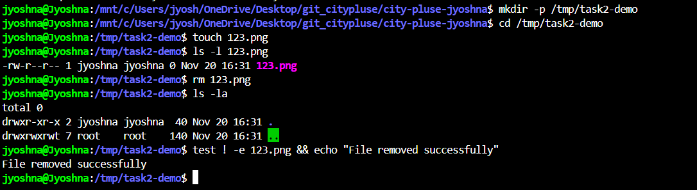
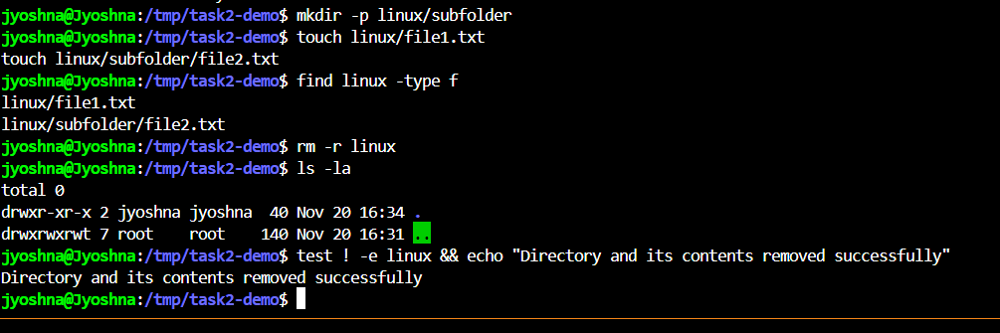
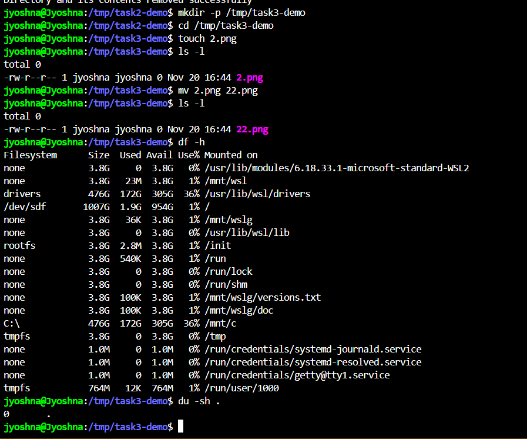
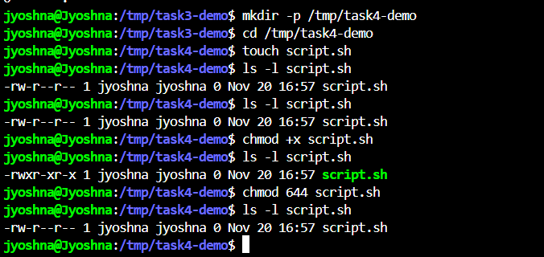
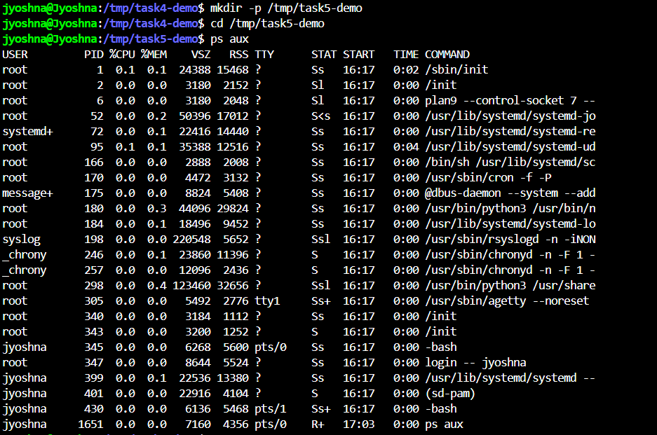
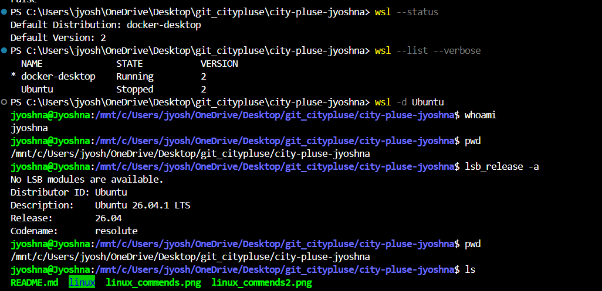

# Atria-CityPulse

This repository documents basic Linux command-line tasks and includes screenshots of the commands being run in the terminal.

## Task 1: Remove Directories

Use `mkdir` to create a directory and `rmdir` to remove an empty directory.

```bash
mkdir temp-dir
rmdir temp-dir
```

`rmdir` only works when the directory is empty. Use `rm -r` or `rm -rf` to remove directories that contain files or subdirectories.



## Task 2: Remove Files and Directories Recursively

Use `rm` to remove a file and `rm -r` to remove a directory and everything inside it.

```bash
# Remove a file
rm 123.png

# Remove a directory and its contents recursively
rm -r linux
```

> Warning: `rm -r` permanently deletes data. Double-check the path before running it.





## Task 3: Rename Files and Check Disk Usage

### Rename a File or Directory

The `mv` command renames a file or directory:

```bash
mv 2.png 22.png
```

### Check Disk Usage

Use `df -h` to see the disk space available on mounted filesystems:

```bash
df -h
```

Use `du -sh` to display the total size of a directory:

```bash
du -sh .
```



## Task 4: Linux Permissions

Linux files and directories have three permission types:

| Permission | Symbol | Meaning |
|---|---|---|
| Read | `r` | View file contents or list directory contents |
| Write | `w` | Modify a file or change directory contents |
| Execute | `x` | Run a file as a program or enter a directory |

Permissions are assigned to:

- The file owner
- The owner's group
- Other users

Use `chmod` to change permissions:

```bash
# Create the script
touch script.sh

# Add execute permission
chmod +x script.sh

# Change permission mode to 644
chmod 644 script.sh
```

View permissions with:

```bash
ls -l script.sh
```

Example permission modes:

- `644`: Owner can read/write; group and others can read.
- `755`: Owner can read/write/execute; group and others can read/execute.
- `777`: All users have read, write, and execute permissions.



## Task 5: List Running Processes

Use `ps aux` to list processes from the entire system:

```bash
ps aux
```





## Screenshot Summary

| Screenshot | Description |
|---|---|
| `task1.png` | Creating and removing an empty directory (`temp-dir`) |
| `task2.png` | Removing a file (`123.png`) |
| `task2_recursive.png` | Removing a directory recursively |
| `task3.png` | Renaming a file (`2.png` to `22.png`) and checking disk usage |
| `task4.png` | Modifying file permissions on `script.sh` with `chmod` |
| `task5.png` | Listing running processes with `ps aux` |
| `wsl.png` | Checking WSL and Ubuntu availability |